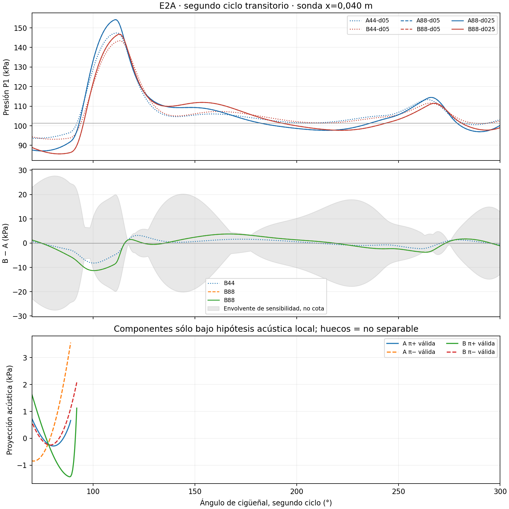
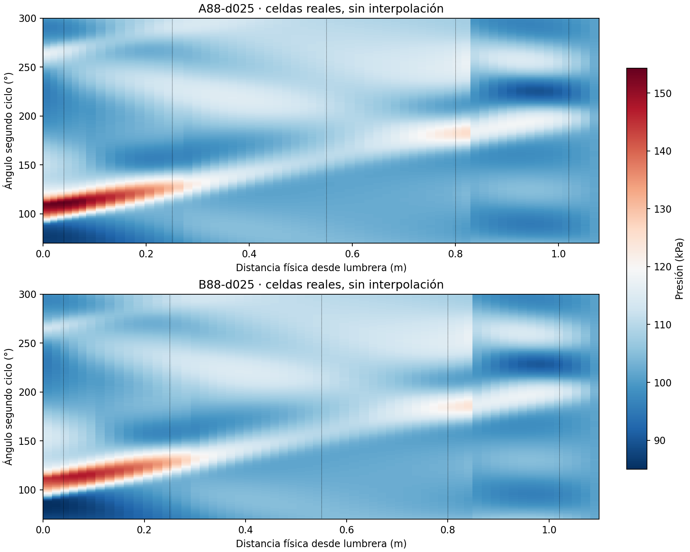

# E2A — ondas de escape A/B: resultado y cierre

2026-10-28. **Dictamen: DIFERENCIA NO RESUELTA.** Se completó la matriz autorizada
dentro del presupuesto, sin modificar el solver. Las señales calculadas difieren,
pero amplitud y fase no superan las envolventes numéricas fijadas antes de correr.
No se demostró un defecto de implementación ni se justifica recomendar B como
mejor diseño. E2A termina aquí; no se inicia E2B, otra malla ni una continuación.

## Configuración efectivamente ensayada

- Protocolo, ejecutor y configuraciones congelados en **`999a95f`** antes de los
  cálculos nuevos: [protocolo](../../docs/gasdynamic/e2a-exhaust-waves-protocol-v1.md)
  y [manifiesto](preparation/manifest.json).
- Motor sintético funcional de 125 cc, **9000 RPM**, dos revoluciones desde su
  arranque independiente. Comparación de ondas en el segundo ciclo, sin declarar
  periodicidad. No es un modelo del X30.
- A: primer tramo **83 mm**, longitud total 1.079 m. B: **103 mm**, total 1.099 m.
  Diámetros y otros largos idénticos. Cada geometría preserva las primitivas
  iniciales: B tiene el inventario adicional correspondiente a su mayor volumen.
  Su superficie de pared se escala geométricamente, sin cambiar h/Tw ni el
  modelo térmico. No se reescribió la configuración histórica B.
- Acoplamiento **V2 experimental** en ambos, con el mismo cierre de tobera ideal
  equivalente; primer orden espacial y SSPRK2/CFL=0.4. Fronteras exteriores
  **OPEN_END_PLENUM_V2**, 101325 Pa y 300 K. Barrido, combustión y Desktop intactos.
- Mallas de **44/88 celdas totales**, 31/62 de escape. Refinamiento inicial
  conservativo dentro de cada diseño; sin remallado de un estado evolucionado.
- Límite nominal de paso **0.5°** y control **0.25°** en las dos mallas finas.
  Muestras físicas comunes cada 0.5°, sin comparar fases desplazadas.
- Sondas a x=0.040/0.250/0.550/0.800/1.020 m desde la lumbrera. Promedio P0 en
  intervalos físicos comunes de 10 mm mediante volumen exacto de frustum,
  no equivalencia ficticia entre índices de celda.

Se reutilizó A44/0.5° de la etapa de lumbreras, verificando hashes y equivalencia
de su estado inicial nativo. No se reanudó ni recalculó. Las otras **cinco**
configuraciones fueron nuevas. Los casos antiguos MUSCL o legacy periódico no
eran compatibles para estimar la incertidumbre de esta misma trayectoria.

## Resultados de presión y fase

Sonda principal **x=0.040 m**, fase **88°–272°** del segundo ciclo. Amplitud es
el máximo de p menos 101325 Pa, no una amplitud de onda reflejada separada.

| Malla / límite nominal | Pico A, kPa sobre ambiente | Pico B, kPa sobre ambiente | Delta B−A, kPa | Fase pico A/B | Retardo B−A por correlación |
|---|---:|---:|---:|---:|---:|
| 44 / 0.5° | 46.068 | 42.108 | −3.960 | 112° / 113° | +1.94790° |
| 88 / 0.5° | 52.858 | 45.450 | −7.408 | 111° / 113° | +2.23043° |
| 88 / 0.25° | 52.858 | 45.450 | −7.408 | 111° / 113° | +2.23048° |

La correlación tiene máximo válido y único según el criterio previo; vale
0.987966 en la pareja de paso reducido. Esto permite describir un retardo de
**señal total**, no atribuirlo a una reflexión específica. +2.23048° equivale
a **41.31 microsegundos** a 9000 RPM.

| Observable, pareja 88/0.25° | Diferencia B−A | Envolvente numérica de decisión | Resultado |
|---|---:|---:|---|
| Pico sobre ambiente | −7.408 kPa | 22.665 kPa | No distinguible |
| Fase del pico | +2.000° | 2.500° | No distinguible |
| Retardo por correlación | +2.23048° | 2.500° (46.30 microsegundos) | No distinguible |
| Impulso de presión | −3.19333 Pa·s | 3.78147 Pa·s | No distinguible |

Para la amplitud, la suma de sensibilidades individuales espaciales es
**10.13295 kPa** y la temporal al límite nominal es **0.000178 kPa**; se aplica
el factor de seguridad dos y se añade el término de muestreo fijado. Para el
impulso, las sumas espacial/temporal son 1.88642/0.000755 Pa·s. La sensibilidad
espacial domina **esta comparación**, aunque no permite deducir el error exacto.

La diferencia de amplitud cambia de −3.960 a −7.408 kPa al refinar. Que su signo
coincida no demuestra por sí solo que esté resuelta: no se supuso cancelación
del error A/B y no se redujo el criterio después de observar los resultados.
Las envolventes son un filtro de robustez de ingeniería basado en sensibilidades,
**no cotas rigurosas, intervalos U95 ni una demostración de régimen asintótico**.
No se calculó GCI con dos mallas.

Normas de diferencia entre diseños en la pareja 88/0.25°: L1=2.91918 kPa,
L2=4.05839 kPa, Linf=11.31029 kPa. Son diferencias A/B sobre la ventana, no
errores contra una solución exacta. Métricas completas: [CSV](metrics.csv),
[señales de las cinco sondas](pressure-probes.csv) y [decisión JSON](decision.json).

## Qué permite decir la propagación y qué no

Los mapas muestran el avance hacia x creciente de la perturbación intensa
después de la apertura y estructuras posteriores de presión en el conducto.
Se representan los frustums reales de cada diseño con una escala de presión
común, sin inventar una trayectoria incidente/reflejada.

**No se pudo identificar de forma válida un retorno reflejado en P1.** En la
ventana 150°–272°, ninguna muestra satisface simultáneamente los controles
acústicos/entrópicos fijados respecto de la referencia local 70°–85°. La figura
de proyecciones sólo muestra los intervalos donde sí pasan esos controles,
principalmente antes del pulso fuerte. No significa que no existan reflexiones:
significa que esta descomposición lineal no las cuantifica allí.

Además, el cilindro está acoplado: cambiar el escape modifica también la
evolución de la fuente de presión y el intercambio del motor. No se impuso una
misma onda incidente prescrita en A/B. Por ello el cambio de pico o el retardo
de señal total no se interpreta automáticamente como tiempo de reflexión ni
como una función de transferencia aislada del escape.

## Alcance real del control temporal

Reducir el límite nominal no redujo a la mitad **todos** los pasos aceptados.
El CFL ya obliga a subdividir muchos pasos del caso 0.5°. En A88 los pasos
aceptados pasan de 2392 a 2884; en B88, de 2391 a 2885. La mediana permanece
**4.630 microsegundos**; el máximo baja de 9.259 a 4.630 microsegundos.

Dentro de la ventana de presión, los pasos pasan de 666 a 737 en A y de
664 a 738 en B. El control sí añade subdivisiones, pero es un límite nominal
más estricto, **no un refinamiento temporal uniforme**. Por eso el pequeño
cambio observado no se presenta como una cota del error temporal restante.
Esta limitación se conserva y no se ejecuta otra prueba para forzar el cierre.

## Coste, conservación e integridad

| Caso | Pared, s | Solver nuevo, s | Pasos nuevos |
|---|---:|---:|---:|
| A44/0.5° reutilizado | 2.568 de lectura | 0 | 0; 1450 históricos |
| B44/0.5° | 24.121 | 23.802 | 1451 |
| A88/0.5° | 58.237 | 57.745 | 2392 |
| B88/0.5° | 57.553 | 57.147 | 2391 |
| A88/0.25° | 56.904 | 56.470 | 2884 |
| B88/0.25° | 58.909 | 58.438 | 2885 |

- Ejecución y análisis internos: **261.142 s**. Incluyendo arranque de los jobs
  y verificación de archivos/recetas: **264.453 s**, por debajo de **600 s**.
  Solver nuevo acumulado: 253.603 s. El coste histórico reutilizado de 24.380 s
  no se cuenta como cálculo nuevo ni como aceleración del solver.
- RSS máximo de las corridas nuevas: **61.46 MiB**, límite 512 MiB.
- Artefactos externos: **20.21 MB**, límite 1 GiB. Preflight con reserva 2 GiB
  aprobado antes de escribir. No se limpiaron históricos.
- Residuos normalizados máximos: masa **1.787e-15**, energía **1.443e-15**,
  especies **1.280e-15**. Todos los casos cumplen sus criterios previos.
- Checkpoints nativos de cierre restaurados exactamente en los seis casos.
  Las cinco corridas nuevas conservan recetas completas de pasos y rechazos.
- Hashes de productor, protocolo, configuraciones, primarias reutilizadas,
  muestras y checkpoints verificados. Fases de muestreo idénticas, estados
  muestreados positivos y finitos. [Verificación](verification.json),
  [recibo de ejecución](execution-receipt.json), [índice externo](artifact-index.json).
- **5 tests del observador PASS**, sin pasos de simulación fuera de la matriz.
  No se reejecutaron campañas ni regresiones extensas del producto sin cambios.
  La regresión P4–P8 anterior (301 PASS/3 SKIP) se conserva como antecedente;
  no se declara como nueva ejecución de E2A.

El código físico coincide con el congelado. rc7, solver, tolerancias, barrido,
combustión y Desktop permanecen intactos. Revisión **SELF_REVIEW**, sin claim
de validación experimental ni revisión independiente.

## Decisión final y parada

**DIFERENCIA NO RESUELTA.** El ensayo muestra respuestas transitorias diferentes
entre escapes, pero no permite calificarlas como una diferencia de fase y
amplitud superior a la sensibilidad numérica según el protocolo adoptado.
Tampoco separa cuantitativamente el retorno reflejado bajo sus hipótesis acústicas.

Esto no demuestra igualdad de los escapes ni un defecto del solver. No permite
deducir incertidumbre de potencia periódica, validar el X30, elegir el escape
más potente ni promover V2 a producción. No se modifica el solver por el resultado.

**Se detiene E2A con la matriz completada.** No se usa el presupuesto sobrante
para otra malla, otro ciclo, una descomposición nueva o E2B. La siguiente decisión
de desarrollo queda fuera de esta ejecución y requiere su propio alcance.
