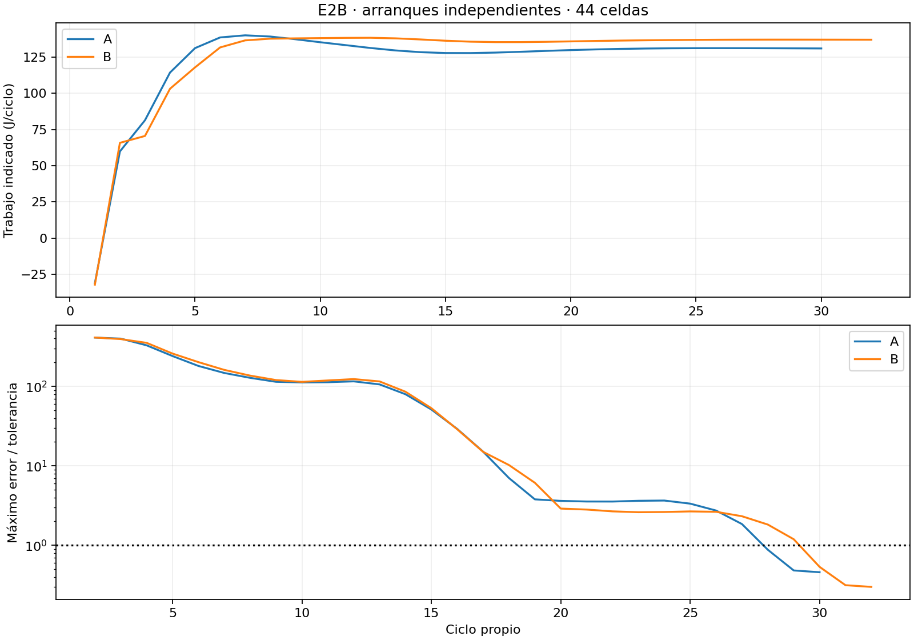
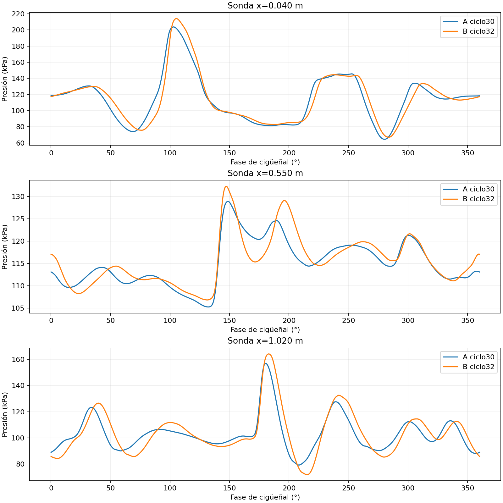
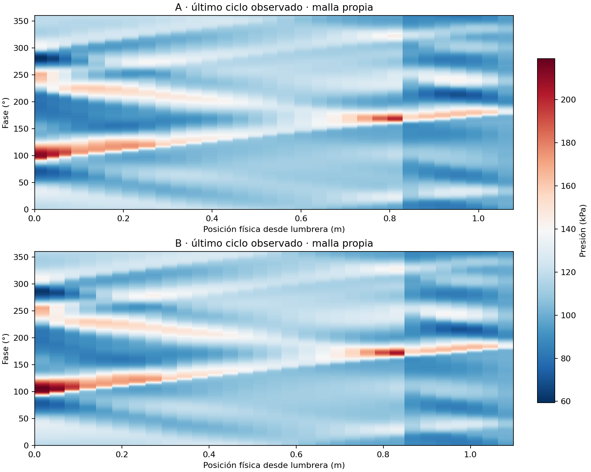

# E2B — comparación periódica A/B con MUSCL V2

**Decisión: E2B_PERIÓDICO_EXPLORATORIO.** Ambos arranques independientes
alcanzaron período 1 con el detector y los umbrales existentes. La diferencia
calculada de potencia es +5,066 % para B; no se ha cuantificado su incertidumbre
de discretización periódica y no se declara numéricamente distinguible.

## Configuración y ejecución

Se ejecutó el [protocolo congelado](../../docs/gasdynamic/e2b-periodic-ab-protocol-v1.md),
prerregistrado en `641d8cc`: 9000 RPM, primer tramo A=83 mm/B=103 mm,
V2 experimental en lumbreras, OPEN_END_PLENUM_V2, MUSCL V2, SSPRK2/HLLC,
CFL=0,4 y 44 celdas totales, 31 en escape. El resto de la física,
inicialización equivalente, tolerancias y modelo de pérdidas se conservaron.
Cada motor arrancó desde su configuración a ángulo cero, sin transferencia de
estados entre A y B. No se usaron curvas legacy como referencia de potencia.

La viabilidad previa utilizó 13–14 s/ciclo medidos, planificación 15 s/ciclo,
100 ciclos máximos por variante y reservas de auditoría/verificación dentro
de 5400 s. No era una garantía de convergencia de B. Los preflight de
almacenamiento original y recuperación fueron PASS, con artefactos fuera del
repositorio; no se eliminó ni trasladó evidencia histórica.

| Magnitud del último ciclo aceptado | A | B |
|---|---:|---:|
| Período detectado | 1 | 1 |
| Ciclo de aceptación | 30 | 32 |
| Trabajo indicado de cilindro, J/rev | 130,9233 | 136,9469 |
| Trabajo del gas sobre pistón del cárter, J/rev | −3,5545 | −3,6617 |
| Trabajo al eje calculado, J/rev | 116,7754 | 122,6918 |
| Potencia indicada, kW | 19,6385 | 20,5420 |
| Potencia al eje calculada, kW | 17,5163 | 18,4038 |
| Torque al eje calculado, N·m | 18,5854 | 19,5270 |
| IMEP, bar | 10,5051 | 10,9884 |
| BMEP, bar | 9,3699 | 9,8446 |
| Aire fresco atrapado al último cierre, mg | 100,4061 | 104,5197 |
| Combustible atrapado, mg | 9,2114 | 9,5710 |
| Carga fresca aire+combustible, mg | 109,6175 | 114,0907 |
| Quemados+residuales / masa total al cierre | 0,27208 % | 0,13920 % |
| Tiempo de simulación, s | 414,7468 | 451,3652 |
| Tiempo del solver, s | 408,0211 | 443,8934 |
| Media de los últimos 5 ciclos, s/ciclo | 13,8755 | 14,3571 |
| Pico RSS de la simulación, MiB | 54,28 | 54,68 |

La pérdida mecánica preservada es FMEP=85000 Pa, identificada como
SYNTHETIC_ASSUMPTION; se suma el trabajo de cárter y se resta la fricción una
sola vez. El resultado al eje es una salida del modelo, no una medición. Las
fracciones se evalúan en el cierre real de escape, fase 272,084717°, validado
contra el evento geométrico y la etapa SSPRK2 correspondiente. No confundir la
etiqueta residual inicial, ya casi purgada, con todo el gas no fresco.

## Evidencia y conservación

- Se conservaron todos los checkpoints y recetas aceptadas. Se restauró cada
  checkpoint nativo y se verificó identidad del estado sin recalcular sus ciclos.
- Se reprodujeron sólo los cuatro ciclos finales necesarios por variante
  (A27–30 y B29–32), con auditoría primaria completa PASS, receta exacta y
  reconstrucción del detector que vuelve a aceptar A30/B32. La repetición
  auditada no equivale a nuevos ciclos físicos de la campaña.
- Máximos residuos globales relativos durante toda A: masa 1,252e−15,
  especies 4,170e−15 y energía 1,029e−14; durante B: 2,683e−15,
  6,376e−15 y 2,047e−14. Estas identidades de contabilidad no son por sí solas
  validación de los cierres físicos ni independencia de malla.
- [Flujos integrados](interface-flows.csv) separa transporte positivo,
  inverso y neto en cada extremo de admisión, tres transfers y escape.
  Los JSON externos conservan también los cuatro componentes de especies y
  energía. No interpretar diferencia entre extremos como creación de masa:
  incluye variación del inventario de cada conducto.
- [Evolución](cycle-evolution.csv) conserva por ciclo trabajo, potencia,
  máximo error/tolerancia, p90, mediana y fallos. La variación de potencia en
  los últimos tres ciclos es descriptiva, **no** incertidumbre numérica.

## Ondas y fase

Las sondas usan posiciones físicas comunes y ventana espacial de 10 mm;
muestreo exacto cada 0,5° en el último ciclo de cada motor. En P1 (x=0,04 m),
el máximo sobre 101325 Pa en la ventana 88–272° pasa de 102,452 a
112,761 kPa; fase de máximo 103,0→105,5°. La correlación da retardo B
de 2,966° y coeficiente 0,994. Esto caracteriza las señales; no identifica
por sí solo una reflexión ni un tiempo de ida/vuelta de una onda separada.

La sonda x=0,55 m no supera el requisito de similitud de forma para admitir
su retardo por correlación (r≈0,893); no se publica ese retardo como medición
válida de propagación. Los máximos locales y la traza completa sí permanecen
disponibles para comparación.

## Recuperación del diagnóstico y coste acumulado

La primera ejecución terminó al derivar la salida de A30: el wrapper nuevo no
adjuntaba la vinculación del detector exigida por la API de métricas periódicas.
Se preservan [recibo original](execution-attempt1-receipt.json) y su clasificación
automática inicial E2B_DEFECTO. La causa fue del exportador de diagnóstico;
no apareció un defecto físico/numérico del solver.

El arreglo `2d955f4` calcula el SHA-256 de la instantánea **real** del detector
y adjunta identidad de configuración, ciclo y estado sólo a la copia derivada.
No modifica el primario canónico, los umbrales ni el solver. La recuperación
se congeló en [recovery-manifest.json](recovery-manifest.json), reutilizó A27–29
ya auditados y A30 ya persistido, y terminó únicamente los replay/audits de B.
No repitió los arranques ni amplió las simulaciones.

Coste acumulado conservador: **1728,891 s (28,815 min) / 5400 s**, incluidos
preparación, verificación, intento original completo, recuperación, auditorías,
sobrecoste medido del lanzador y posprocesamiento. No incluye investigación
bibliográfica externa, que no es ejecución numérica E2B. El tamaño externo
indexado es 158387696 bytes (151,05 MiB). [Índice con hashes](artifact-index.json)
y [decisión estructurada](decision.json).

Verificación: 28 tests focales PASS; regresiones P4–P8 301 PASS/3 SKIP;
5 tests del wrapper corregido PASS. No se cambió `motorsim/`, Desktop ni rc7.
Revisión: SELF_REVIEW; evidencia numérica L2, sin validación experimental.

## Límite de la conclusión y cierre

La comparación es periódica **en esta malla y formulación**. El aumento calculado
de 887,46 W no queda acreditado como un cambio de diseño numéricamente
distinguible: falta incertidumbre espacial y temporal de potencia periódica.
Las envolventes transitorias de P1 no se reutilizan para suplirla. Tampoco
puede afirmarse cuál escape reproduce mejor un motor real sin mediciones.

**E2B cerrado como E2B_PERIÓDICO_EXPLORATORIO.** No se ejecutaron otras RPM,
refinamientos periódicos, warm start ni etapas posteriores. Conservar este
resultado y detener la ejecución al entregar.
