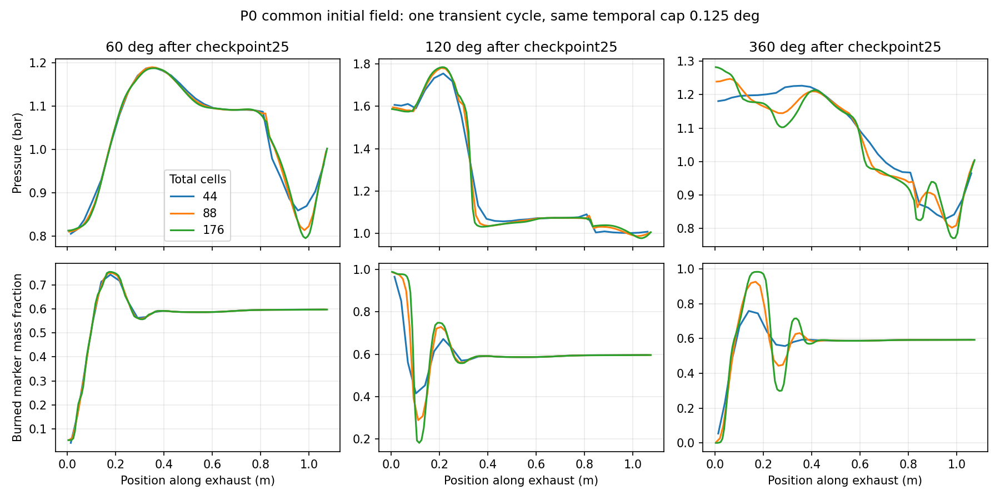

# Representación inicial y evolución espacial desde checkpoint25

2026-10-27. Diagnóstico L1 / **SELF_REVIEW**. Modelo sintético A9000,
acoplamiento tobera V2, MUSCL de frontera V2 y OPEN_END_PLENUM_V2. rc7 intacta.
No validación experimental, periodicidad ni independencia de malla.

## Qué se hizo

Cinco casos nuevos de una revolución9000–9360°, reutilizando88/P0/.125° del
estudio anterior. Protocolo y enmienda commiteados antes de sus ejecuciones.
Dos campos subcelda admisibles: P0 constante y P1 lineal limitada conservativa
desde las **celdas originales**, sin reconstrucción recursiva. Mantienen las
medias originales de Euler, momento y cuatro componentes de composición.
P1 es una hipótesis de información desconocida; no una solución de referencia.

Mallas44/88/176 son el total del motor; el escape tiene31/62/124 celdas en
1.079m. Geometría, combustión, CFL, SSPRK2, HLLC, fronteras y tolerancias sin
cambios. Sólo se añadió instrumentación diagnóstica y proyección inicial.

## Resultados integrados

| Representación / celdas | Paso máximo real, grados | Trabajo J | IMEP bar | Salida bruta mg |
|---|---:|---:|---:|---:|
| P0 /44 | .125 |131.089659|10.518456|180.970350|
| P0 /88, reutilizado | .125 |131.053516|10.515556|203.464932|
| P1 /88 | .125 |131.036471|10.514188|203.520527|
| P0 /176 | .125 |131.197605|10.527117|213.475787|
| P1 /176 | .125 |131.185919|10.526179|213.523629|
| P0 /176, medio paso | .0625 |131.198856|10.527217|213.474131|

No hubo entrada en la salida en ninguna etapa SSPRK2; aquí salida neta y bruta
coinciden. Sí hubo reversión cilindro–escape, registrada por separado. El
incremento espacial de salida disminuye22.4946→10.0109mg. El trabajo es poco
sensible, **pero no monótono**: no se calcula Richardson/GCI para certificarlo.
Una revolución transitoria tampoco representa potencia periódica.

## Separación de contribuciones

### Representación inicial ensayada

Errores relativos de inventarios y restricción Euler iniciales<2e-15; todos
los componentes de cada padre se conservan. Presión y fracciones de los hijos
P1 difieren de P0: conservar medias no equivale a conservar el campo puntual.
Inicialmente, en el escape, el contraste P0/P1 tiene presión L1≈.00409 y
quemados L1≈.00179 (fracción absoluta). Ninguna celda requirió reducir theta
por positividad en esta evidencia.

Después de la evolución, la diferencia P0/P1 de quemados es.0002563 en88 y
.0005197 en176; el caudal cambia.0273% y.0224%, respectivamente. El trabajo
cambia.0130% y.00891%. Esta familia inicial **no explica** el cambio espacial
de salida12.43% entre44/88 ni4.92% entre88/176. No constituye una cota para
todas las posibles estructuras subcelda.

### Evolución espacial

Normas al terminar, después de restringir **ambas soluciones a los mismos
volúmenes físicos44**:

| Contraste | Presión relativa L1 | Quemados, fracción absoluta L1 |
|---|---:|---:|
| P0:44→88 |.02048366|.01250410|
| P0:88→176 |.00998366|.01266880|
| P1:44→88 |.02052750|.01255535|
| P1:88→176 |.00999462|.01288341|

La presión mejora; la composición no demuestra contracción en estas mallas.
En particular, la fracción quemada máxima final pasa.7582→.9258→.9826 y los
cruces de.5 pasan de uno a tres. El perfil grueso no resuelve la separación
entre capas de gases; no se trata sólo de trasladar un único frente.
No se infiere un orden asintótico para esas estructuras ni se exige acuerdo
puntual en discontinuidades. `comparison-final.json` conserva L1/L2/Linf,
inventarios, centroides, variación total y todos los cruces. La razón variación
total/gradiente máximo es descriptiva; no es la anchura de un único frente.

Antes de abrir el escape ya existen diferencias: a60° el máximo local de
presión44/176 se sitúa en x≈.9897m y es7.96%. Eso localiza una contribución de
propagación/salida distinta del acoplamiento cilindro–escape. No separa todavía
propagación, geometría y reflexión entre sí.

Hasta120°, los flujos positivos de cada especie que entran al escape desde el
cilindro44/176 coinciden hasta≈2.2e-22kg por intervalo30°. Aun así se desarrollan
perfiles de composición distintos. Hay evidencia directa de contribución del
transporte/representación espacial con donantes prácticamente iguales. Más
tarde cambian también los caudales y las composiciones donantes: no atribuir
toda la discrepancia final a difusión escalar aislada.

La contabilidad explica el incremento de caudal44/88: el inventario del escape
cambia+0.49384mg en44 y−18.16692mg en88. La diferencia22.49458mg de salida se
descompone en+3.83382mg de aporte neto desde el cilindro y18.66076mg menos
almacenados. No es un aumento equivalente de aire atrapado ni de potencia.

### Control temporal

En176 hay2882 pasos con mediana.125°, frente a5762 con mediana.0625°.
Al reducir el paso, cambian el trabajo.000953% y la salida.000775%.
En volúmenes comunes44: presión L1=7.99e-5 y quemados L1=5.84e-6, frente a
.00998 y.01267 del contraste espacial88/176. La sensibilidad temporal ensayada
es mucho menor. Esto no es una cota rigurosa del error temporal exacto ni prueba
que todos los observables tengan el mismo orden.

### Coordenada material: evidencia adicional de transporte

En un conducto sin fuentes de masa/especies,
`a(x,t)=integral_0^x rho*A dx - integral_0^t mdot_left dt` satisface
`a_t+u*a_x=0`; cada marcador también se advecta. Calor y compresión no crean
marcadores. Esto permite comparar con la distribución original retenida sin
confundir desplazamiento o compresión con mezcla.

Se escogió un intervalo seguro común a∈[.0000443336,.0017927598]kg: está por
encima de toda la descarga bruta hacia el cilindro y permanece dentro del
escape al final. No hubo reentrada por la salida en ninguna etapa; ese material
original no pudo salir y volver a entrar. La comparación exacta de los campos
P0 por tramos en esa coordenada da cambios de quemados L1=.01291/.01023/.00552
para44/88/176. Incluye representación final y mezcla numérica.

Para separar el error de representar una discontinuidad por una celda, también
se integra el perfil original sobre cada intervalo material final y se compara
con su media. El residual de quemados resulta.00798/.00779/.00376; las celdas
que cruzan los bordes se excluyen y los intervalos cubiertos se registran
explícitamente, por lo que no se ajusta un orden con esos tres números.

Esto muestra una contribución numérica al transporte del material retenido y
su reducción al refinar, **no un defecto demostrado del esquema**. Para gas
inyectado o reingresado la historia donante puede variar; el invariante inicial
no se usa como referencia exacta fuera del intervalo retenido.

## Conservación, recuperación y coste

- Máximo residual por especie/conducto8.27e-19kg; masa por conducto2.51e-18kg.
  Los balances globales conservan sus fuentes de combustión y calor.
- Se verificó restauración nativa exacta de estado y ledger de los seis casos,
  sin recalcular trayectorias. Los estados intermedios son FAST+receta;
  no se presentan como checkpoints nativos.
- Cinco casos nuevos:568.75s de pared en sus bucles instrumentados, dentro de
  720s; cada caso respetó120s o240s. Son costes diagnósticos, no benchmark de
  producto. El88/P0 se reutilizó, no se cobró como ejecución nueva.
- Artefactos≈9.6MB, preflight con reserva2GiB; sin limpiezas ni traslados.
- 16 tests focalizados PASS. No cambio de `motorsim/`, física o detector.
  No se repitieron campañas históricas ni aceptación Desktop.

## Dictamen y siguiente decisión

**Sensibilidad de evolución espacial demostrada, con transporte numérico
material; independencia de composición no demostrada.** La representación
P0/P1 y el paso temporal ensayados no explican la mayor parte del efecto de
malla en caudal/presión. La física produce capas reales de composición variable;
la malla modifica cuánto se mezclan y cómo se propagan sus ondas. Su fidelidad
experimental permanece indeterminada. No hay un defecto reproducido que
justifique modificar MUSCL, HLLC, tobera V2 o salida.

No avanzar a campaña periódica extensa. Antes conviene un único refinamiento
adicional352/P0 con.0625°, comparado con176/medio-paso ya disponible, para saber
si empieza a contraerse el error de las capas resueltas. Su alcance y coste
deben quedar registrados antes de ejecutarlo. No convertir ese diagnóstico en
una secuencia ilimitada ni promover candidatos por un resultado transitorio.

Evidencias principales: `initial-analysis.json`, `comparison-final.json`,
`material-cell-average-analysis.json`, `donor-history-analysis.json`,
`decision-metrics.json`; configuraciones, recetas y checkpoints por caso.
